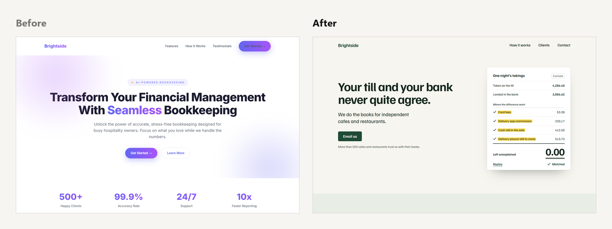

# Elevate

**"Make it better" finally works.**

You've typed "make it better" more times than you'd like to admit. And it keeps coming back longer, with more adjectives and a gradient nobody asked for. What it doesn't find is the thing that was actually wrong.

Elevate finds it.

It's a free skill you install once. Then you keep talking to your AI exactly the way you do now. Say "make it better" or "this is meh", and instead of polishing, your AI works out what's really holding the work back and fixes that. A post that explains everything starts pulling the reader in, and a page that looks like every other AI site gets an idea of its own.

No more going round in circles. You get back the version you had in your head and couldn't quite put into words.

There's nothing new to learn and no style guide to write. You don't even have to say what's wrong. That's Elevate's job.



<p align="center"><sub>Two real homepages, before and after. That's the kind of jump Elevate is built for.</sub></p>

## What's inside

Elevate gives your AI the eye of a top editor and a senior designer who can spot AI-made work from across the room. It even bans its own name: "elevate" sits on its [list of AI filler](skills/elevate/references/writing.md#the-tells), alongside "delve" and "unlock".

**Say it however you say it.** "Boring", "cringe", "make it pop" and "more premium" are four different problems, and Elevate hears the difference.

**Small fixes stay small.** If the work is nearly there, you get a light repair that keeps everything you liked. If it isn't working, you get a fresh angle.

**No new kind of slop.** It won't swap AI clichés for anti-AI ones, so you never trade "seamless" for a riddle.

**Still sounds like you.** Your own writing comes back in your voice, and nothing gets made up to look impressive.

It works on posts, emails, headlines and names, web pages and app screens, slides, image prompts and documents.

## Three lines

> Our wood-fired pizzas combine fresh ingredients with hand-stretched dough for an authentic Italian experience.

> Spend less time cooking and more time enjoying delicious food with the people you love.

> You've cooked all week. We've got tonight.

The first describes the pizza. The second describes the outcome, and that's where most "better" rewrites stop. The third leaves room, so the reader finishes the thought with their own reasons and feels it was written about them.

That third line is the level Elevate writes at.

## More before and after

A newsletter that was nearly there ("close, maybe 8/10"). Elevate cut four lines and touched nothing else:

> Here's what surprised me. Everyone else just paid. Two people said it was about time, which means I'd been undercharging them for longer than I want to admit, and that's the real lesson here.

> Everyone else just paid. Two people said it was about time.

A LinkedIn opener:

> I stopped doing free discovery calls. Here's why. 🚫📞

> You can usually see what's wrong long before a discovery call ends, and then you have to decide whether to say so.

An image prompt for a post about not answering email straight away:

> A glowing holographic AI assistant with charts and graphs floating around, a robot hand, vibrant blue and purple neon colors, 8k, trending on artstation.

> A small, bright waiting room where every seat is taken by an envelope. One of them has tipped onto its neighbour as if it has nodded off.

## Get it

It's free.

**Manus.** Open Skills > + Add > Import from GitHub, paste `https://github.com/EvolutionUnleashed/elevate`, then click Import.

**Claude app.** [Download elevate.zip](https://github.com/EvolutionUnleashed/elevate/releases/latest/download/elevate.zip), then open Customize > Skills, choose Upload a skill and pick the file. No code needed. If your menu looks different, [here's Anthropic's guide](https://support.claude.com/en/articles/12512180-use-skills-in-claude).

**Claude Code.**

```
/plugin marketplace add EvolutionUnleashed/elevate
/plugin install elevate@elevate
```

**Codex, Cursor, Copilot, Gemini CLI and 40+ other agents.**

```
npx skills add EvolutionUnleashed/elevate
```

Then say "make it better". That's the whole interface.

---

**Next time you type "make it better", you'll get better.**

If Elevate earns its keep, a star helps other people find it.

Created by Stu Jordan, founder of Evolution Unleashed, a community of 65,000 people putting AI to work. [AgentGuru](https://agentguru.ai/?utm_source=github&utm_medium=readme&utm_campaign=elevate) · [MIT license](LICENSE)
